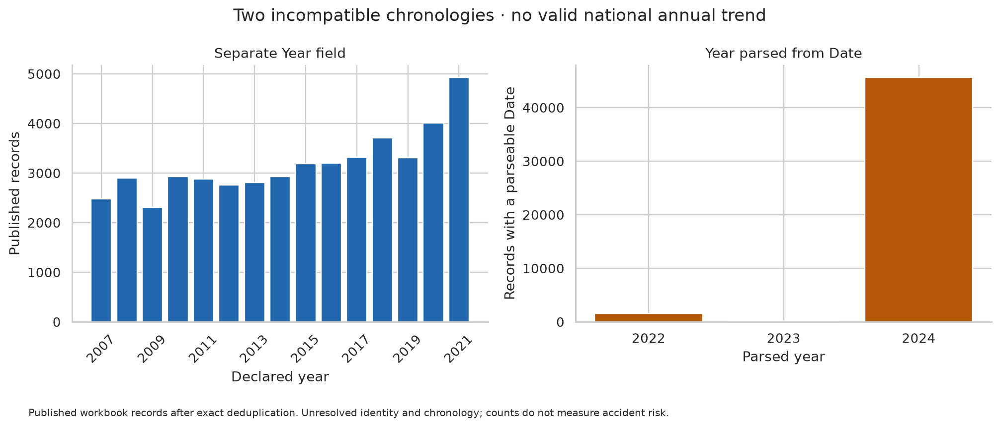
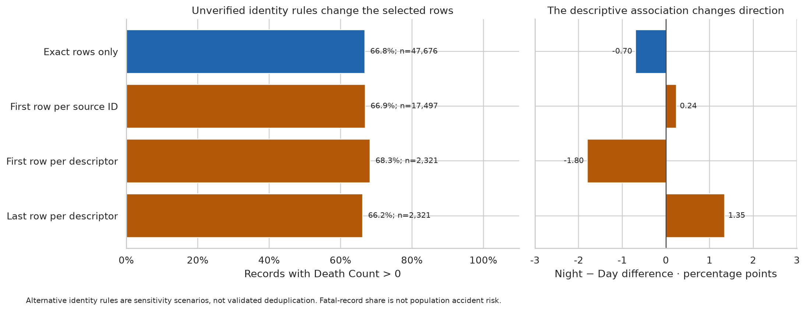

# Bangladesh Road Accident Data Quality Audit & Exploratory Analysis

**Can this published workbook support a year-by-year comparison of road accidents in Bangladesh?** After removing four exact duplicate rows, all 47,533 parseable dates disagree with the separate year field. No record meets the date/year consistency rule. The audit documents what happened to the denominator at each step and why a national trend or risk ranking would be unsupported.

[Start with the source notebook](notebooks/00_dataset_and_source_assessment.ipynb) · [Source-quality report](reports/data_quality_report.md) · [Analytical report](reports/analytical_report.md)

## Notebook guide

| Open in order | Question |
| --- | --- |
| [00 · Dataset and source assessment](notebooks/00_dataset_and_source_assessment.ipynb) | What was deposited, and can rows be attributed to the named institutions? |
| [01 · Missingness, duplicate patterns, and preparation](notebooks/01_source_quality_and_cleaning.ipynb) | Can any chronology or identifier support a reliable incident cohort? |
| [02 · Exploratory patterns in published records](notebooks/02_eda_statistics_and_visualization.ipynb) | What do the recorded fields show and where do they disagree? |
| [03 · Descriptive statistics and identity sensitivity](notebooks/03_statistics_and_identity_sensitivity.ipynb) | Does the recorded lighting association survive different row-selection rules? |
| [04 · Data suitability and conclusions](notebooks/04_data_suitability.ipynb) | Which analyses can proceed and what source evidence is missing? |



## Evidence from the deposited workbook

| Check | Result | Consequence |
| --- | --- | --- |
| Release description vs file | The publisher describes 49,566 records. The single workbook contains **47,680 rows × 31 columns**. | The release provides no accounting for the difference of 1,886 rows. |
| Exact duplicates and missingness | Four exact duplicates removed, leaving **47,676 records**. There are zero raw null cells, 143 unparseable dates and 19 unusable coordinate strings. | Structured fields can appear complete while their contents fail validation. |
| Chronology | Declared years span 2007–2021. Parsed dates span 2 Jan 2022 to 3 Dec 2024. **47,533 of 47,533** parseable dates conflict with year, and 43,812 disagree with month. | Counts by each field describe the workbook. Comparable annual or seasonal incident totals are unavailable. |
| Incident identity and overlap | 17,497 distinct source IDs and 2,321 candidate descriptor groups. In **1,929 groups**, reported fatality values conflict. | Removing additional rows would require an unverified identity rule. |
| Geographic coverage | One coordinate pair appears on 45,506 rows. There are 175 distinct parseable pairs. | Concentration in the file cannot identify a hazardous location. |
| Source lineage | The publisher names ARI, BRTA, DMP, MP Unit and field forms. The workbook lacks row-level institution labels, separate extracts and a transformation log. | Source overlap and changes in reporting coverage remain unresolved. |

The unit of analysis is a **workbook record**. There is no verified incident key or traffic exposure denominator. Counts and casualty-field sums cannot establish unique crashes, a national death toll, a causal effect or the probability of a crash. Resolving those questions requires source-level records, definitions and exposure data. [Coverage inventory](reports/tables/source_coverage.csv) · [Column inventory](reports/tables/column_inventory.csv) · [Geographic coverage](reports/geographic_coverage.json)

## Methods and sensitivity

- **Pandas and NumPy** preserve each retained row’s original worksheet position, normalize missing tokens, parse dates and hemisphere-marked coordinates, and flag field disagreements. Only exact row duplicates are removed from the primary analytical copy. Matching on date, time, location, narrative and vehicle information produces candidate groups for sensitivity analysis.
- **SQLite** models records and a many-to-many participant bridge. Joins count each participant type once per source row. Separate year and month summaries preserve the conflicting fields. Participant mentions overlap across categories. [SQL queries](sql/) · [Data dictionary](docs/data_dictionary.md)
- **SciPy and NumPy** summarize recorded associations with Cramér’s V, Spearman correlation and a conditional cluster bootstrap. The Night-minus-Day difference in the share of records with a positive fatality count is **−0.70 percentage points**. The 95% descriptor-cluster bootstrap reference interval is **−1.78 to +0.29 points**. Its interpretation depends on unverified grouping and independence assumptions.
- Taking the first vs last workbook row per candidate group yields differences of **−1.80 vs +1.35 points**. Worksheet order even changes the sign. These scenarios illustrate identity uncertainty. Population-risk confidence intervals and inferential p-values are withheld. [Scenario table](reports/tables/duplicate_sensitivity.csv) · [Statistical output](reports/statistics.json) · [Methodology](docs/methodology.md)



## Source and reproduction

Fernaz Nur and Arafat Sahin Afridi published Mendeley Data **version 2** on 17 October 2025, DOI `10.17632/p2kgkb5cd2.2`. The official archive contains one modified XLSX workbook and matches the publisher’s SHA-256. Source-derived outputs use CC BY 4.0 with attribution. Original code uses MIT. [Official release](https://data.mendeley.com/datasets/p2kgkb5cd2/2) · [Source manifest](reports/source_manifest.json) · [License notice](NOTICE.md)

From the project root, use CPython 3.13 on Linux for the audited environment. Use `requirements.txt` for other supported versions (Python 3.11+).

```sh
python3 -m venv .venv
. .venv/bin/activate
python -m pip install -r requirements-lock.txt
python -m pip install -e .
python -m bd_safety all
```

The command acquires and verifies the archive, cleans a copy, builds SQLite, analyzes the records, renders Matplotlib and Seaborn figures, executes all five notebooks and runs the checks. For manual acquisition, download the listed **Accident_Dataset final.zip** from the v2 release. If Download All wraps the listed ZIP, extract the inner ZIP. Run `python -m bd_safety all --archive '/path/to/Accident_Dataset final.zip'`. Original files and personal-detail text stay out of the Git repository. [Download contract](docs/data_sources.md)

Once the local workbook, cleaned CSV, database and reports are available, open the notebooks with the project environment as the kernel. Each notebook can run from the project root or `notebooks/` without executing the others first. Refresh their outputs with `python -m bd_safety notebooks`. To edit the maintained notebook source, change `scripts/create_notebooks.py`, run it to regenerate the notebooks, then refresh the outputs.

```sh
python -m unittest discover -s tests -v
python -m bd_safety check
```

The first command runs software tests without data. The second reconciles completed pipeline outputs. A passing check confirms faithful reproduction of the audit. The source-quality assessment remains unresolved. GitHub Actions defines software and schema checks on Python 3.11 and 3.13 and an optional real-data run. [Workflow](.github/workflows/checks.yml) · [Final validation](reports/final_validation.json)

## Repository guide

| Location | Contents |
| --- | --- |
| [src/bd_safety](src/bd_safety/) and [sql](sql/) | Acquisition, parsers, cleaning, SQL model, summaries, statistics and reporting |
| [notebooks](notebooks/) and [scripts](scripts/) | Five executed notebooks and their editable source generator |
| [reports](reports/) | Analytical and quality reports, ten figures, 28 aggregate CSVs and validation evidence |
| [docs](docs/) and [tests](tests/) | Provenance, field definitions, statistical assumptions and software tests |
| `data/` | Local original ZIP and workbook, cleaned CSV, runtime files and SQLite model |
