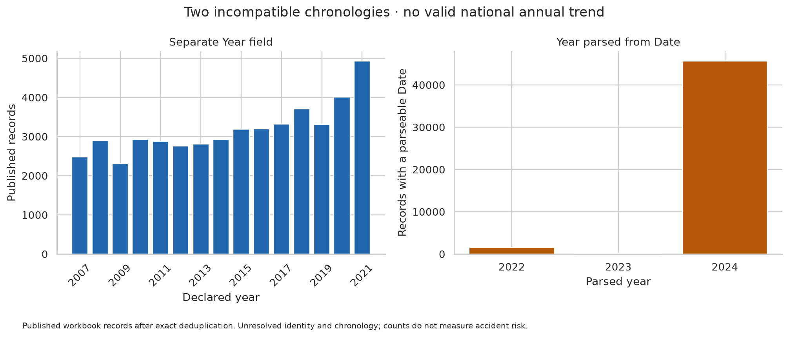
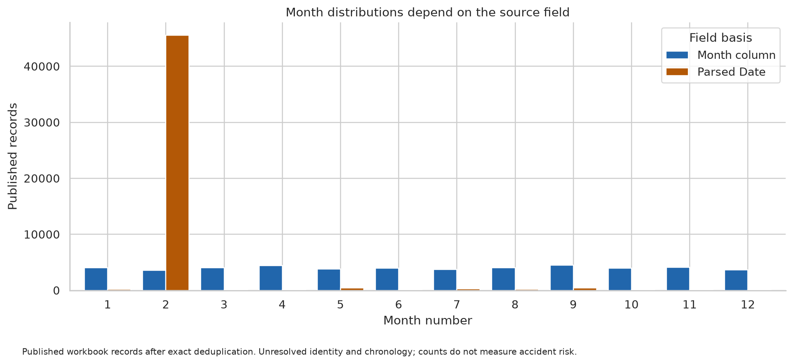
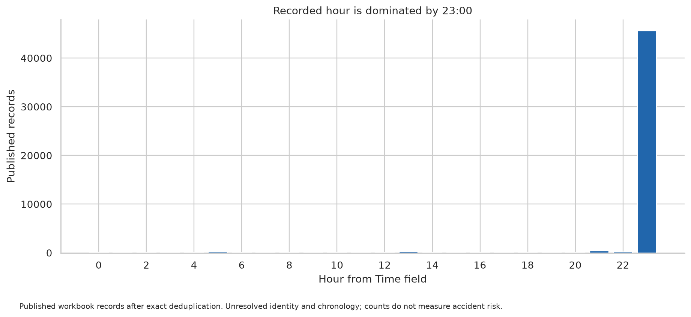
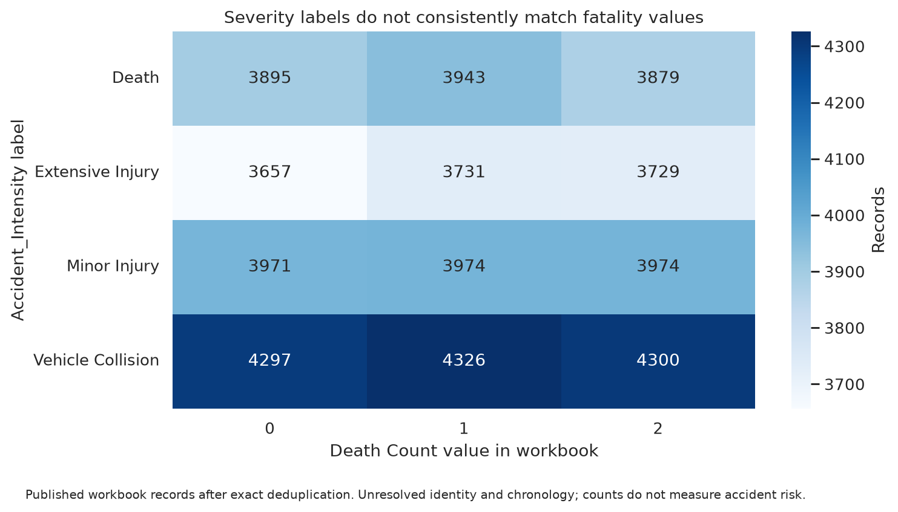
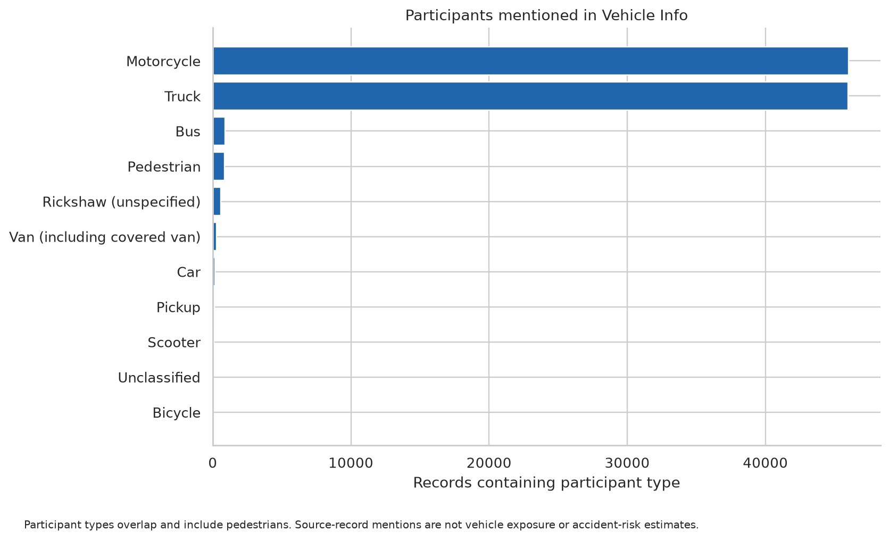
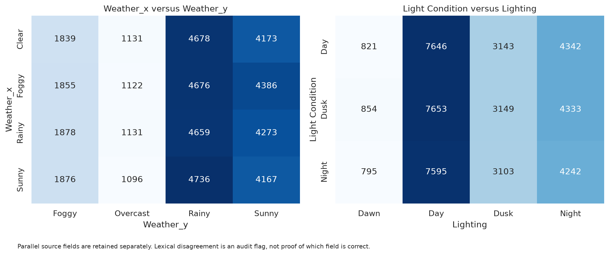
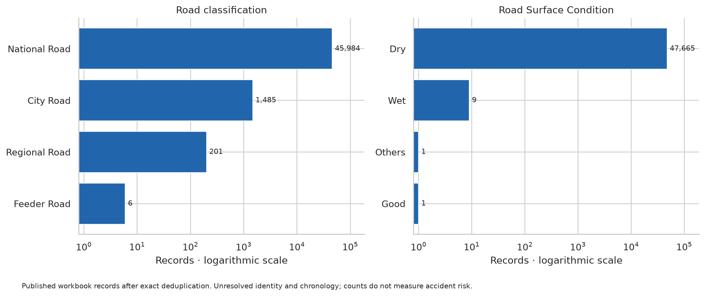
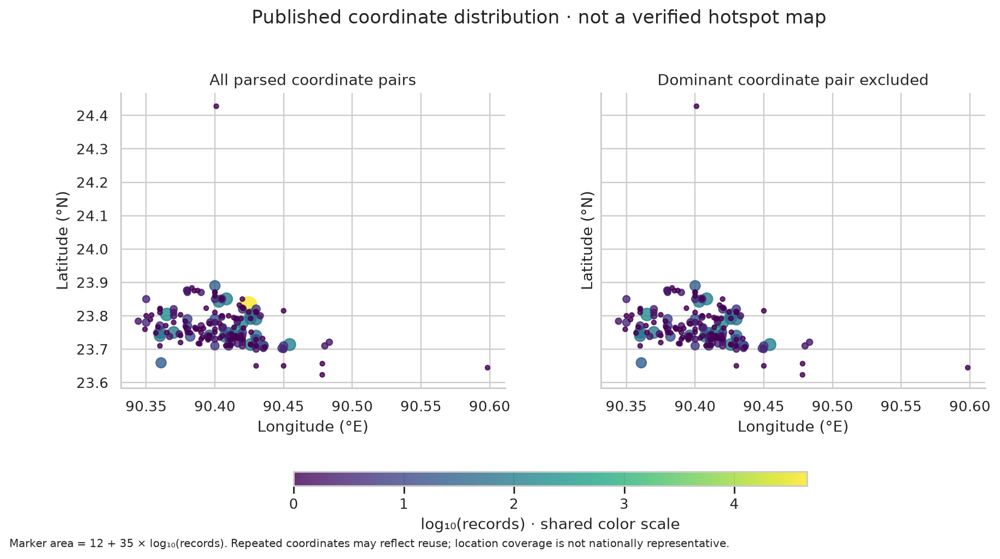
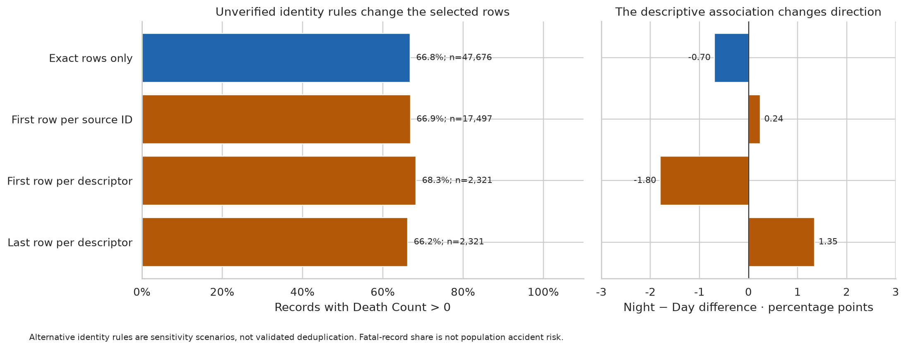
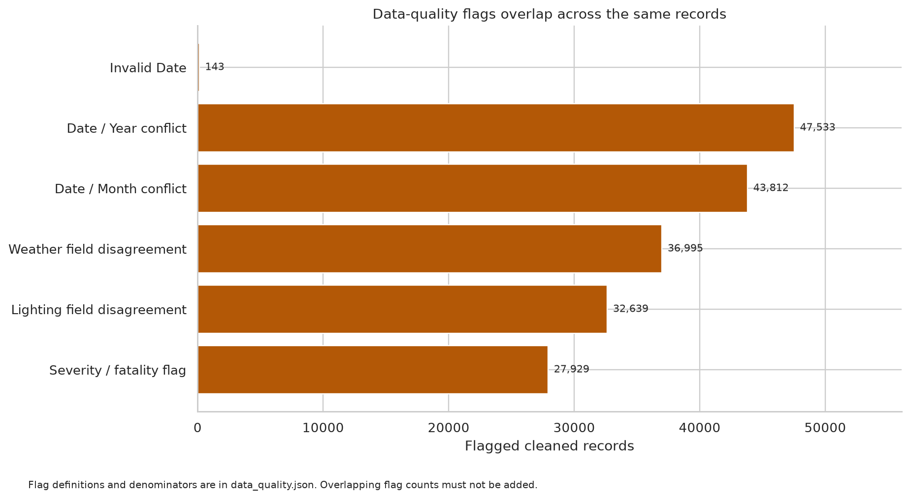

# Bangladesh Road Accident Data Quality Audit & Exploratory Analysis

## Executive assessment

**This source is not suitable for reliable national trends, accident-risk estimation, or causal safety conclusions.** The defensible portfolio outcome is a reproducible source-quality audit plus clearly bounded exploratory analysis of published records. The original Mendeley version 2 ZIP was downloaded successfully and matches the publisher's checksum; no manual download was required.

There are 47,680 original rows and 47,676 after removal of 4 exact duplicate rows. All 47,533 parseable dates conflict with the separate Year field. There is no row-level source attribution to resolve overlapping institutional coverage. Repeated identifiers and descriptor templates make the number of independent accidents unknown. Read the [quality report](data_quality_report.md) before interpreting any chart.

## Questions and analytical boundaries

The intended questions concern temporal patterns, recorded severity, vehicle/participant involvement, road/weather conditions, and geographic concentration. This workbook permits inspection of how those fields are distributed and whether they agree. It does **not** support claims that one road, vehicle, weather condition, hour, or place has a higher probability of accident. There are no traffic volume, distance traveled, population-at-risk, vehicle fleet, or uninjured exposure denominators.

The unit below is an exact-deduplicated workbook record. `fatal_record_share` means the proportion of selected records with numeric Death Count > 0, not a person's probability of dying, road-user fatality risk, or severity of a verified unique accident. Summed casualty values can double-count repeated events and have unresolved consistency issues.

## Source and quality findings

Source authors: Fernaz Nur and Arafat Sahin Afridi. Release: Mendeley Data v2, DOI `10.17632/p2kgkb5cd2.2`, CC BY 4.0. The artifact is one modified XLSX workbook with 31 columns. The archive and workbook hashes are recorded in [source_manifest.json](source_manifest.json).

| Audit | Observed result | Interpretation |
| --- | --- | --- |
| Original workbook | 47,680 rows × 31 columns | One sheet; modified research workbook |
| Exact duplicates | 4 | Removed only from cleaned copy; 47,676 rows remain |
| Raw null cells | 0 | Non-null does not establish measurement completeness or accuracy |
| Unparseable Date | 143 | Retained as missing parsed date; original workbook preserved |
| Date versus Year conflicts | 47,533 / 47,533 parseable dates | No defensible unified annual trend |
| Date versus Month conflicts | 43,812 / 47,533 | No defensible seasonality claim |
| Invalid coordinate strings | 19 | No coordinate imputation or swapping without hemisphere evidence |
| Weather field lexical disagreement | 36,995 / 47,676 | Both source fields retained; neither declared correct |
| Lighting field disagreement | 32,639 / 47,676 | Time, Light Condition, and Lighting are distinct measurements |
| Severity/fatality flag disagreement | 27,929 / 47,676 | Death label versus Death Count > 0; definition is an audit assumption |

No institution-specific dataset or mapping was included. The source description mentions overlapping ARI, BRTA, DMP, MP Unit, and form-based contributions. The available fields cannot establish that these sources were deduplicated, independently verify their collection procedures, or identify source-specific reporting changes. Absence of ordinary null cells is not proof of complete data.

## Temporal patterns: incompatible source fields

The declared Year range is 2007–2021; Date parses to 2022-01-02–2024-12-03. **No growth rate, annual safety improvement, seasonal effect, or comparable national year series is reported.** The chart compares field distributions to diagnose the source. The strict date/year-consistent cohort is empty.

The modal time appears in 45,550 records (95.54%). This is a source concentration requiring validation, not evidence that accident risk peaks at that time. Broad time bands are exported, but hour-level counts cannot adjust for road use or potential template reuse.

## Recorded severity and casualty fields

Numeric fatality values sum to 47,738 and injury values to 95,049 across cleaned rows. **These sums are not a verified death or injury toll.** 66.82% of cleaned records have Death Count > 0. The flag comparing label `Death` with positive numeric Death Count disagrees in 27,929 records; the source supplies no codebook to reconcile the two definitions. Severity labels are retained separately and not silently converted to a numeric scale.

## Participant, road, and environmental distributions

Participant types are extracted using transparent token patterns from Vehicle Info, including pedestrians as road users. Records can mention several participants; counts overlap. A dominant repeated vehicle description cannot establish real-world vehicle risk. Road-user exposure, fleet sizes, and verified incident attribution are unavailable.

Weather and light columns are displayed separately because they disagree extensively. Lexical disagreement is a screening flag; category definitions may also differ. No claim is made about which field is correct or that environmental factors have no safety effect.

Road-field distributions are highly concentrated; counts use logarithmic axes where labeled to retain minority categories. They describe source composition and cannot identify hazardous road types.

## Geographic coverage

There are 47,657 records with parseable coordinates and 175 distinct coordinate pairs. Observed latitude is 23.62319–24.42760°N and longitude 90.34425–90.59843°E. The dominant pair is reused in 45,506 records. This limited numeric extent and street/highway labels do not establish nationwide coverage. No validated district/division codes or boundary join are provided, so no district ranking is invented. The right panel removes the dominant coordinate pair solely to inspect the remaining distribution; it is not a validated cleaned hotspot map.

## Statistical relationships and uncertainty

| Published field vs fatal-record flag | Cramér's V | Minimum expected cell |
| --- | --- | --- |
| lighting | 0.0117 | 819.60 |
| light_original | 0.0073 | 5221.24 |
| weather_y | 0.0105 | 1486.57 |
| weather_x | 0.0070 | 3922.48 |
| severity_label | 0.0034 | 3688.88 |
| road_class | 0.0126 | 1.99 |

Cramér's V summarizes the strength of association **within the published fields**. Pearson chi-square discrepancies, degrees of freedom, and expected cell counts are retained for audit; inferential p-values are withheld because independent verified incident units and measurement validity have not been established. Sparse road-category expected cells also make usual asymptotic test assumptions questionable. Fatality and injury values have descriptive Spearman rank correlation -0.0009; this says nothing reliable about the true relationship between crash severity and injuries.

Using `Lighting`, the Night-minus-Day difference in fatal-record share is -0.70 percentage points (12,917 Night records, 22,894 Day records). A conditional descriptor-cluster percentile bootstrap gives a 95% **model reference interval** of -1.78 to 0.29 pp (2,000 resamples; seed 42; 2,212 groups represented in Day/Night rows). Descriptor groups are only computational clusters. Their independence and incident identity are unverified. **This interval is not a validated accident-level or population-risk confidence interval** and does not quantify source error, duplicated events, or causal effects. It is included to make the conditional resampling mechanics and their limitations inspectable. Safety decisions must not use it.

## Identity and duplicate sensitivity

| Scenario | Rows | Share with Death Count > 0 | Sum of Death Count values | Night−Day difference (pp) |
| --- | --- | --- | --- | --- |
| Exact-row deduplication only | 47,676 | 66.82% | 47,738 | -0.70 |
| One earliest row per source ID (unverified identity) | 17,497 | 66.91% | 17,537 | 0.24 |
| One earliest row per descriptor group (unverified identity) | 2,321 | 68.29% | 2,358 | -1.80 |
| One latest row per descriptor group (unverified identity) | 2,321 | 66.22% | 2,312 | 1.35 |

There are 2,321 normalized descriptor groups, but they are not a count of verified accidents. Of these, 1,929 contain conflicting numeric fatality values. If, only as a what-if assumption, each group were one incident, its possible fatal-record share lies between 14.35% and 95.00% using within-group minima and maxima. These are conditional identification bounds, **not confidence limits**. First/last-row and ID-based alternatives illustrate dependence on unresolved identity choices; none is accepted as the correct deduplication.

## Recommended next steps

1. Request the original institutional extracts, collection definitions, field codebook, source identifiers, merge keys, imputation rules, and transformation script from the depositors. Resolve the completely inconsistent chronologies before any temporal comparison.
2. Establish an incident identifier and reconcile overlapping source coverage. Manually review candidate duplicates and conflicting casualty/condition values against original records; preserve a decision log.
3. Validate coordinates and administrative codes against an authoritative boundary source. Obtain appropriate traffic/exposure denominators before estimating road, vehicle, weather, or geographic risk.
4. Re-run this audit on a corrected, separately versioned release. Only then consider incident-level severity comparisons or operational safety recommendations.

No particular road-user group, location, or condition is recommended as a safety target from this artifact. No causal claims, machine-learning predictions, national fatality estimates, or fabricated incident corrections are provided.

## Reproduction

See [README](../README.md), [methodology](../docs/methodology.md), [source notes](../docs/data_sources.md), executable [SQL](../sql/), and two [notebooks](../notebooks/). Local `data/processed/cleaned_records.csv` and `accident_records.sqlite3` are reproducible derivatives, excluded from Git with original data. Aggregate tables, audit JSON, report, and figures are versionable evidence. [final_validation.json](final_validation.json) validates implementation fidelity; [data_quality.json](data_quality.json) preserves the distinct substantive quality failure.
